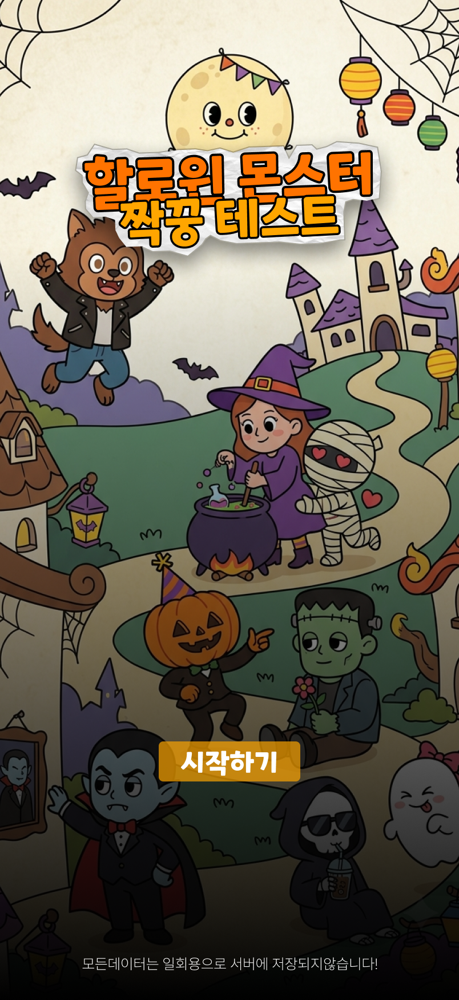
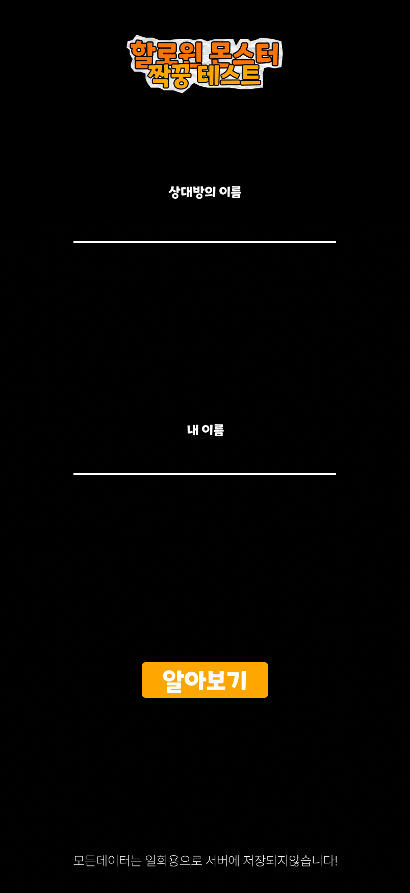
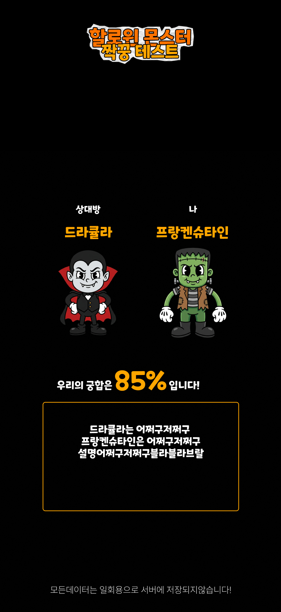

🎃 몬스터 짝꿍 릴레이션 개발 명세서 (PNG 시각적 참조 버전)

본 문서는 첨부된 PNG 디자인 시안을 기반으로, AI 코딩 에이전트(Cursor, Windsurf, Claude Dev 등)가 UI 레이아웃, 컬러, 컴포넌트 배치를 시각적으로 해석하여 Next.js + Tailwind CSS 환경에서 개발을 진행할 수 있도록 작성된 명세서입니다.

1. 레퍼런스 디자인 (PNG)

⚠️ AI 에이전트 지침: 아래 이미지들을 시각적으로 분석하여 배치를 파악하고, Tailwind CSS 클래스를 활용해 모바일 화면 크기에 맞게 똑같이 구현하세요.

1.1 메인 화면 디자인

분석 포인트:

배경 레이아웃 및 타이틀 폰트 스타일/위치

이름 입력창(Input) 2개의 배치, 배경색, 테두리, 라운딩, 플레이스홀더

[궁합 확인하기] CTA 버튼의 컬러, 호버 효과, 위치 및 크기

1.2 결과 화면 / 모달 디자인

분석 포인트:

상단 궁합 점수(%) 표시 스타일 및 폰트

좌/우 몬스터 캐릭터 에셋 배치 (Person 1 몬스터 vs Person 2 몬스터)

케미 타이틀, 케미 분석 텍스트 박스, 주의사항 박스의 디자인 및 여백

[링크 복사 / 공유하기], [다시 하기] 버튼 하단 배치

2. 뷰포트 & 레이아웃 사양 (모바일 고정)

데스크톱 환경에서도 항상 모바일 뷰(430px 너비)로 고정되어 노출되어야 합니다.

// app/layout.tsx
export default function RootLayout({ children }: { children: React.ReactNode }) {
  return (
    <html lang="ko">
      <body className="bg-slate-950 min-h-screen flex items-center justify-center p-0 md:py-8 font-sans">
        {/* 모바일 430px 고정 프레임 */}
        <main className="w-full max-w-[430px] min-h-screen md:min-h-[932px] md:h-[932px] relative overflow-y-auto overflow-x-hidden shadow-2xl rounded-none md:rounded-[40px] bg-slate-900 border-0 md:border md:border-slate-800">
          {children}
        </main>
      </body>
    </html>
  );
}

3. 데이터 및 비즈니스 로직

3.1 8종 몬스터 정의 (lib/monsters.ts)

export interface Monster {
  id: string;
  name: string;
  traits: string;
  dialogue: string;
  imagePath: string;
}

export const MONSTERS: Monster[] = [
  { id: 'dracula', name: '드라큘라', traits: '완벽주의, 예민함', dialogue: '각도 1도만 틀어져도 신경 쓰이거든?', imagePath: '/assets/monsters/dracula.png' },
  { id: 'werewolf', name: '늑대인간', traits: '감정파, 도파민', dialogue: '오늘 밤 보름달 떴다! 가자아아악!!', imagePath: '/assets/monsters/werewolf.png' },
  { id: 'frankenstein', name: '프랑켄슈타인', traits: '과묵함, 순정', dialogue: '말은 적게, 마음은 크고 깊게.', imagePath: '/assets/monsters/frankenstein.png' },
  { id: 'jack_o_lantern', name: '잭오랜턴', traits: '친구, 분위기메이커', dialogue: '사탕 안 줘도 파티는 계속된다!', imagePath: '/assets/monsters/jack.png' },
  { id: 'witch', name: '마녀', traits: '계산적, 야망가', dialogue: '네 마음도 내 연성 레시피에 들어있어.', imagePath: '/assets/monsters/witch.png' },
  { id: 'mummy', name: '미라', traits: '집착, 애정결핍', dialogue: '절대 안 풀어줄 거야, 평생 내 곁에 있어.', imagePath: '/assets/monsters/mummy.png' },
  { id: 'grim_reaper', name: '저승사자', traits: '시니컬, 쿨가이', dialogue: '아이스 아메리카노 한 잔 마실 시간만 줘.', imagePath: '/assets/monsters/grim.png' },
  { id: 'ghost', name: '유령', traits: '장난꾸러기, 츤데레', dialogue: '딱히 너 좋아서 따라다니는 거 아니거든?', imagePath: '/assets/monsters/ghost.png' },
];

3.2 매칭 및 궁합 점수 로직 (lib/calculator.ts)

export function getNameHash(name: string): number {
  return name.split('').reduce((acc, char) => acc + char.charCodeAt(0), 0);
}

// 입력 이름 기반 0~7 몬스터 인덱스 산출
export function getMonsterIndex(name: string): number {
  return getNameHash(name) % 8;
}

// 두 사람의 이름을 조합하여 0~100점 점수 산출
export function getCompatibilityScore(name1: string, name2: string): number {
  const hash1 = getNameHash(name1);
  const hash2 = getNameHash(name2);
  return Math.abs((hash1 * 31 + hash2 * 17) % 101);
}

4. AI 에이전트 개발 순서 (Prompt Guidelines)

AI 에이전트에 본 문서를 제공한 후 다음 단계로 명령을 실행하도록 요청하세요.

Step 1 (디자인 이미지 분석):

문서에 삽입된 main_screen.png와 result_screen.png 시안을 스캔하고, 구성 요소별 Tailwind CSS 매핑 계획을 세웁니다.

Step 2 (레이아웃 구축):

app/layout.tsx에 데스크톱 중앙 정렬 430px 고정 프레임 구조를 작성합니다.

Step 3 (메인 화면 구현):

app/page.tsx에 PNG 시안과 똑같은 위치, 색상, 정렬을 가진 입력폼(Input 2개)과 실행 버튼을 만듭니다.

Step 4 (로직 및 결과 화면 연동):

lib/calculator.ts 및 lib/monsters.ts 알고리즘을 연결하여 결과 페이지/모달을 생성합니다.

result_screen.png 시안과 동일한 텍스트 카드, 이미지 배치, 점수 디자인을 복원합니다.

Step 5 (인터랙션 구현):

URL 파라미터 기반 결과 공유 및 클립보드 링크 복사 버튼을 완성합니다.